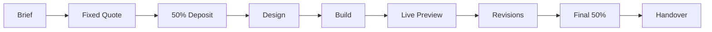

<div align="center">
  
</div>

<h1 align="center">Farmoz</h1>

<h3 align="center">High-Performance Websites &amp; AI Automations</h3>

<p align="center">
  Fast, conversion-focused landing pages and custom AI tools for small businesses.<br/>
  <strong>Fixed price. Fixed timeline. No surprises at the end.</strong>
</p>

<p align="center">
  <a href="https://wa7181633-rgb.github.io/farmoz-site/"></a>
  <a href="https://wa.me/923122581354"></a>
  <a href="mailto:farmoz98@gmail.com"></a>
</p>

<p align="center">
  
  
  
</p>

---

## Verified Performance

Real audit output, not a claim. Run against the live site with my own free CLI:

```text
site-audit — free website report
https://wa7181633-rgb.github.io/farmoz-site/

  ████████████████████  100/100  (245 ms, 21.7 KB)

  ✔ HTTPS                        secure
  ✔ Response time                245 ms
  ✔ Page weight (HTML)           21.7 KB
  ✔ Title tag                    63 chars
  ✔ Meta description             137 chars
  ✔ Mobile viewport              present
  ✔ Single H1                    1 found, 6 H2
  ✔ Image alt text               no images
  ✔ Social preview (Open Graph)  title + image
  ✔ Favicon                      present
  ✔ Canonical URL                present
  ✔ Content depth                826 words

Everything passed.
```

You can reproduce it yourself — the tool is free and open source:

```bash
git clone https://github.com/wa7181633-rgb/site-audit
cd site-audit
node audit.mjs yourdomain.com
```

---

## What You Get

<table>
<tr>
<td align="center" width="25%">
<h2>5 days</h2>
<strong>Typical Turnaround</strong>
<br/>
<sub>1-page sites, from brief to live</sub>
</td>

<td align="center" width="25%">
<h2>1–2</h2>
<strong>Revisions</strong>
<br/>
<sub>Included, depending on package</sub>
</td>

<td align="center" width="25%">
<h2>100%</h2>
<strong>Code Ownership</strong>
<br/>
<sub>Full source + domain in your name</sub>
</td>

<td align="center" width="25%">
<h2>&lt;1.5s</h2>
<strong>Load Target</strong>
<br/>
<sub>Mobile-first, no framework bloat</sub>
</td>
</tr>
</table>

---

## Services &amp; Pricing

| Package | Investment | Best for | What's included |
|:---|:---|:---|:---|
| **Starter** | **$149** | Single-product landing page | 1 page · 5-day delivery · 1 revision · contact form + WhatsApp · SEO basics · full source |
| **Business** | **$349** | Growing small business | Up to 5 pages · custom design · blog/catalogue structure · on-page SEO + sitemap · 10-day delivery · 2 revisions |
| **AI Build** | **from $499** | Operations &amp; lead gen | Scope call + written spec · custom chatbot or workflow · tool integrations · handover guide · 30 days of fixes |

**Payment:** 50% to book the slot, 50% when the site is live and you're happy. No hourly billing, no hidden extras.

---

### 🧩 Templates

Launch-ready HTML/CSS you can buy today and deploy in an hour. No build step.

| Template | Price | What it is |
|:---|:---|:---|
| **Atlas** | **$29** | Dark dashboard / map UI. Built for data-heavy products and location tools. |
| *Nordic* | *Coming soon* | Calm, minimal SaaS landing page for apps, courses and newsletters. |
| *Bloom* | *Coming soon* | Warm storefront for boutiques, bakeries and handmade brands. |

→ [**Get Atlas**](https://wa.me/923122581354) · [See all templates](https://wa7181633-rgb.github.io/farmoz-site/#templates)

---

## Selected Work

### [Farmoz — Portfolio &amp; Agency Site](https://wa7181633-rgb.github.io/farmoz-site/)


Conversion-focused sales page with full pricing, FAQ and contact flow.

`HTML5` `CSS3` `Vanilla JS` `GitHub Pages` — **scored 100/100** on site-audit · [Live](https://wa7181633-rgb.github.io/farmoz-site/)

### [Atlas — Interactive Map Dashboard](https://wa7181633-rgb.github.io/atlas/)


Single-file dashboard template with live filters, stat cards and dark product UI. No build step.

`HTML` `Vanilla JS` `MIT licensed` — [Live](https://wa7181633-rgb.github.io/atlas/) · [Repo](https://github.com/wa7181633-rgb/atlas)

### [site-audit — Free Website Auditor](https://github.com/wa7181633-rgb/site-audit)

Zero-dependency CLI that scores any site on SEO, speed, mobile readiness and social previews — 12 weighted checks, one command, nothing sent anywhere.

```bash
node audit.mjs example.com
```

`Node.js 18+` `Zero deps` `MIT licensed` — [Repo](https://github.com/wa7181633-rgb/site-audit)

---

## How We Work Together



1. **Brief** — a short call or chat. What you sell, who buys it, what the site must achieve.
2. **Fixed quote** — price and a real delivery date before any work starts.
3. **Build &amp; preview** — you click through a staging link and give feedback.
4. **Revisions &amp; handover** — 1–2 rounds, final payment, then full code and domain control handed to you.

---

## Technical Approach

<p align="center">
  
  
  
  
  
  
</p>

**Frontend** — semantic HTML, hand-written modern CSS (Grid/Flex, custom properties), vanilla JS where it counts. I skip heavy frameworks on purpose: they're often 200 KB of JavaScript to render a heading, and they wreck Core Web Vitals on the mid-range phones most customers actually use.

**Delivery** — mobile-first from 360px, accessible (semantics, focus states, contrast), SEO-complete (titles, meta, Open Graph, structured data, sitemap, canonical).

**AI layer** — prompt systems for consistent output, LLM-assisted content and QA, and automation workflows that connect forms, email, WhatsApp, Google Sheets and reporting.

---

## FAQ

<details>
<summary><strong>Do I get full ownership of the code?</strong></summary>

Yes. You receive the full source files, a deployed site, and the domain/hosting account in **your** name. Nothing is locked to me — if you ever want another developer, everything is yours.
</details>

<details>
<summary><strong>How long does a website take?</strong></summary>

A one-page site is typically **5 working days** from the day I receive your text and images. A five-page site is around **10 working days**. You get a real date before we start, not a range.
</details>

<details>
<summary><strong>Do I need to write the content myself?</strong></summary>

No. Send your existing material — brochures, WhatsApp messages, anything — and I'll structure the copy. I don't invent claims about your business; anything I write, you approve.
</details>

<details>
<summary><strong>How does payment work?</strong></summary>

50% upfront to book the slot, 50% when the site is live and you're happy. Bank transfer, Wise, or any method that works in your country.
</details>

<details>
<summary><strong>Can you maintain the site afterwards?</strong></summary>

Yes, optionally. Small text and image updates are a flat monthly retainer, or per-update if you prefer. You're never forced into it.
</details>

<details>
<summary><strong>Do you work with clients outside Pakistan?</strong></summary>

Yes — most work is remote and async. Calls are scheduled in your time zone.
</details>

---

## GitHub

<div align="center">


</div>

---

<div align="center">

## Ready to build something fast?

One short message is enough. I reply within 24 hours — and I'll tell you honestly whether I'm the right person for the job.

[](https://wa.me/923122581354)
[](mailto:farmoz98@gmail.com)
[](https://wa7181633-rgb.github.io/farmoz-site/)

<br/>

**Web Engineering · AI Automation · Templates · GitHub Pages · SEO**

<sub>Star a repo if it helped you. Built with care by Farmoz.</sub>

</div>
