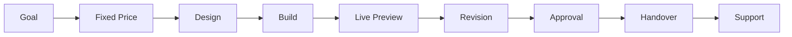

<div align="center">
  
</div>

<div align="center">

# Farmoz

### Web Engineering · AI Automation · Conversion-Focused Landing Pages

Building fast websites and AI automations that turn small businesses into lead machines.

[](https://wa7181633-rgb.github.io/farmoz-site/)
[](mailto:farmoz98@gmail.com)
[](https://wa.me/923122581354)
[](https://github.com/wa7181633-rgb)

<br/>

**Fixed price. Fixed timeline. One revision included. No surprises.**

</div>

---

## About Me

I'm **Farmoz**, a web engineer and AI automation builder from **Pakistan**, working with clients worldwide.

I build **fast, conversion-focused websites** for small businesses and **AI automations** that remove repetitive work — lead replies, data sorting, report generation, and the copy-paste tasks that quietly eat hours every week.

My approach is simple: **no heavy frameworks, no bloat, no mystery**. Semantic HTML, modern CSS, and vanilla JavaScript, deployed free on GitHub Pages — which means excellent Core Web Vitals and near-zero hosting cost for the client.

> **A website isn't valuable because it looks good. It's valuable when it turns a visitor into a customer.**

---

## What I Deliver

<table>
<tr>
<td align="center" width="25%">
<h2>100</h2>
<strong>Lighthouse Target</strong>
<br/>
<sub>Performance, SEO, best practices</sub>
</td>

<td align="center" width="25%">
<h2>0</h2>
<strong>Dependencies</strong>
<br/>
<sub>No build step, no npm install</sub>
</td>

<td align="center" width="25%">
<h2>&lt;24h</h2>
<strong>Response Time</strong>
<br/>
<sub>WhatsApp or email</sub>
</td>

<td align="center" width="25%">
<h2>1</h2>
<strong>Free Revision</strong>
<br/>
<sub>Included in every project</sub>
</td>
</tr>
</table>

<div align="center">

**Landing pages · Business websites · AI automations · GitHub Pages deployment**

</div>

> These are the standards I hold my work to, not vanity metrics. Where a number appears, it's a target or a policy — not an inflated claim.

---

## Services

| Service | What you actually get | Best for |
|:---|:---|:---|
| **Landing Pages** | Lightning-fast one-page site that converts visitors into leads or sales | Coaches, consultants, local services, product launches |
| **Business Websites** | Clean 3–6 page site with services, pricing, FAQ + WhatsApp/email contact flow | Shops, clinics, agencies, startups |
| **AI Automations** | Scripts & workflows that answer leads, sort data, generate reports, and kill busywork | Anyone drowning in copy-paste or repetitive tasks |

**My promise:** Fixed price + fixed delivery date before we start. One free revision round. You only pay the rest when you're happy.

---

## Selected Projects

| Project | Description | Live |
|:---|:---|:---|
| **[farmoz-site](https://github.com/wa7181633-rgb/farmoz-site)** | Agency-grade sales page for a web + AI studio. Zero dependencies, deploys free on GitHub Pages. | [Live Demo](https://wa7181633-rgb.github.io/farmoz-site/) |
| **[atlas](https://github.com/wa7181633-rgb/atlas)** | Single-file interactive map dashboard — live filters, stat cards, dark product UI. Perfect starter for location-based businesses. | [Live Demo](https://wa7181633-rgb.github.io/atlas/) |
| **[elevate-demo](https://github.com/wa7181633-rgb/elevate-demo)** | Premium coaching landing page — conversion-focused, dark UI, full sections (services, pricing, testimonials, FAQ). | [Repo](https://github.com/wa7181633-rgb/elevate-demo) |
| **[site-audit](https://github.com/wa7181633-rgb/site-audit)** | Free zero-dependency CLI that scores any website on SEO, speed, mobile & social previews. Run it before hiring anyone (including me). | Run locally |

---

## How a Project Works

```text
1. You share the goal          →  I send fixed price + clear deadline
2. 50% to start                →  Design + build begins
3. Live preview for review     →  One revision round included
4. Final 50% on approval       →  Handover + domain/hosting help
```

Simple. Transparent. No scope creep.



---

## Tech & Approach

<p align="center">
  
  
  
  
  
  
</p>

### Frontend Engineering

<p>


</p>

- **No heavy frameworks** — vanilla JS and hand-written CSS for speed you can measure.
- **Mobile-first** — designed at 360px first, then scaled up.
- **Accessible** — proper semantics, focus states, colour contrast.
- **SEO-ready** — titles, meta description, Open Graph, structured data, sitemap.
- **Zero dependencies** — no build step, no supply-chain surface, deploys anywhere.

### AI & Automation

```text
Lead comes in
      │
      ▼
  Automation
      │
 ┌────┼────────────┐
 ▼    ▼            ▼
Reply  Sort      Report
 │    │            │
 └────┼────────────┘
      ▼
Email / WhatsApp / Sheets
```

`Prompt Systems` · `LLM APIs` · `Content Generation` · `QA Workflows` · `Email Automation` · `WhatsApp Integration` · `Google Sheets Pipelines`

- **Prompt systems** — structured prompts for consistent, on-brand output.
- **LLM-assisted content & QA** — drafting, reviewing, and catching issues before handover.
- **Automation scripts** — connecting email, WhatsApp, Google Sheets, and reporting flows.

---

## GitHub

<div align="center">


</div>

---

## Let's Work Together

I'm currently **available** for a limited number of projects so every build gets proper attention.

- 📩 **Email:** [farmoz98@gmail.com](mailto:farmoz98@gmail.com)
- 💬 **WhatsApp:** [Chat now](https://wa.me/923122581354) — fastest response
- 🌐 **Portfolio:** [wa7181633-rgb.github.io/farmoz-site](https://wa7181633-rgb.github.io/farmoz-site/)
- 📍 **Based in:** Pakistan — working with clients worldwide

---

<div align="center">

### Ship it. Measure it. Improve it.

**Web Engineering · AI Automation · Conversion Design · GitHub Pages · SEO**

<br/>

**Star a repo if it helped you.**  
Built with care by **Farmoz**.

</div>
