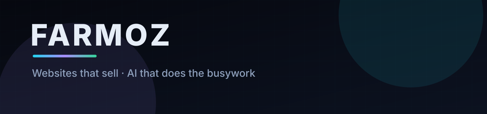
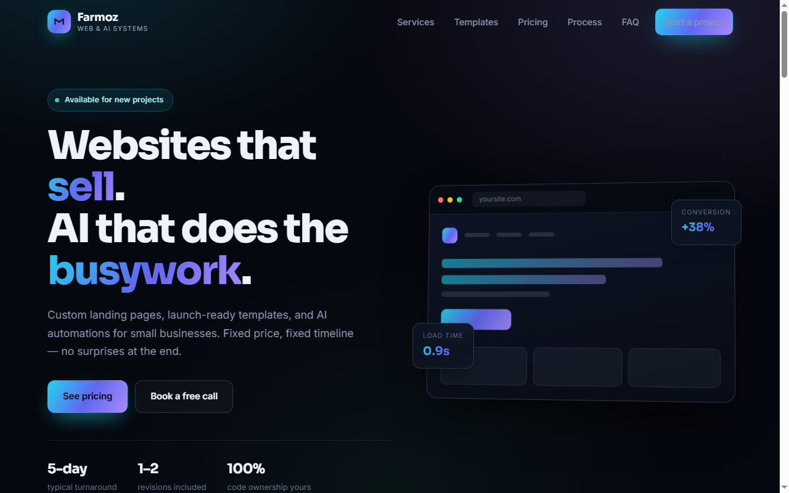
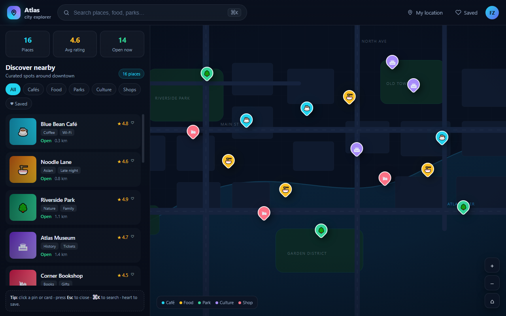

<div align="center">
  
</div>

<h1 align="center">Fast websites for small businesses.<br/>Fixed price. Live in 5 days.</h1>

<p align="center">
  <strong>From $149</strong> &nbsp;·&nbsp; you own the code and the domain &nbsp;·&nbsp; 50% deposit, 50% when it's live
</p>

<p align="center">
  <a href="https://wa.me/923122581354"></a>
  <a href="https://wa7181633-rgb.github.io/farmoz-site/"></a>
</p>

<p align="center">
  <sub>One developer — you talk to the person who builds it. Based in Pakistan, working worldwide. Replies within 24 hours.</sub>
</p>

---

## Selected Work

<table>
<tr>
<td width="50%" align="center">
<a href="https://wa7181633-rgb.github.io/farmoz-site/"></a>
<br/>
<strong>Farmoz — Portfolio &amp; Sales Site</strong>
<br/>
<sub>Conversion-focused page with transparent pricing, FAQ and contact flow</sub>
<br/>
<sub><code>HTML</code> <code>CSS</code> <code>Vanilla JS</code> · <a href="https://wa7181633-rgb.github.io/farmoz-site/">Live</a></sub>
</td>
<td width="50%" align="center">
<a href="https://wa7181633-rgb.github.io/atlas/"></a>
<br/>
<strong>Atlas — Dashboard Template</strong>
<br/>
<sub>Single-file dark dashboard with stat cards and an <em>illustrated</em> map panel</sub>
<br/>
<sub><code>HTML</code> <code>Vanilla JS</code> <code>MIT</code> · <a href="https://wa7181633-rgb.github.io/atlas/">Live</a> · <a href="https://github.com/wa7181633-rgb/atlas">Repo</a></sub>
</td>
</tr>
</table>

<sub><strong>Note on Atlas:</strong> the map is a hand-drawn SVG illustration, not a live tile map (no Leaflet or Mapbox). If you need real geographic data, that's a custom build — ask me.</sub>

---

## Pricing

Fixed. Published. No "contact us for a quote" games.

| Package | Price | Timeline | What you get |
|:---|:---|:---|:---|
| **Starter** | **$149** | 5 days | 1 landing page · mobile-first · contact form + WhatsApp button · SEO basics · 1 revision · full source |
| **Business** | **$349** | 10 days | Up to 5 pages · custom design · blog or catalogue structure · on-page SEO + sitemap · 2 revisions · full source |
| **AI Build** | **from $499** | scoped | Written spec first · one chatbot or one workflow · up to 2 tool integrations · handover guide · 30 days of fixes |
| **Larger build** | *quoted on scope* | — | Multi-page apps, dashboards, or more than 2 integrations — I'll give you a fixed number, not an hourly rate |

**How payment works:** 50% to book the slot, 50% when the site is live on a preview link and you're happy. **You see the finished site before you pay the second half.**

**AI Build, in plain terms:** you pay your own API and hosting costs directly — I don't mark them up. Scope is capped at one workflow and two integrations; anything beyond that is a separate written quote.

---

### 🧩 Template: Atlas — $29

Launch-ready HTML/CSS/JS. No build step, no dependencies, deploy in an hour.

Dark dashboard shell with stat cards, filter controls and an illustrated map panel. MIT licensed — take it, modify it, ship it.

→ [**Live preview**](https://wa7181633-rgb.github.io/atlas/) · [**Get it — $29**](https://wa.me/923122581354)

---

## How I Work

1. **Brief** — a short call or chat. What you sell, who buys it, what the site must do.
2. **Fixed quote and date** — both in writing before any work starts.
3. **Build and preview** — you click through a live staging link and tell me what's wrong.
4. **Revisions, then handover** — 1–2 rounds included. Final payment only after that. Then you get the full source and the domain is in your name.

**No lock-in.** After handover, everything is yours: the code, the domain, the hosting account. If you ever want a different developer, nothing is held hostage. I'd rather you stay because the work is good.

---

## Live Proof

I scored my own site with my own tool. Read this with the caveat attached — it's the honest version.

<p align="center">
  
  
  
</p>

<details>
<summary><strong>What the 12 checks actually test (and what they don't)</strong></summary>

<br/>

```text
site-audit — https://wa7181633-rgb.github.io/farmoz-site/
Score: 100/100 · 245 ms · 21.7 KB HTML · 826 words

  ✔ HTTPS              ✔ Title tag           ✔ Canonical URL
  ✔ Response time      ✔ Meta description    ✔ Content depth
  ✔ Page weight        ✔ Mobile viewport     ✔ Open Graph tags
  ✔ Favicon            ✔ Single H1           ✔ Image alt text
```

**What this does NOT measure.** The tool reads the raw HTML only. It does not measure real-world render speed, Core Web Vitals (LCP, CLS, INP), or JavaScript errors. A 100/100 here means the markup is clean and complete — not that the page feels fast on a cheap Android phone. I say this because I'd rather you trust the number for exactly what it is.

**Run it yourself on any site, including mine:**

```bash
git clone https://github.com/wa7181633-rgb/site-audit
cd site-audit
node audit.mjs yourdomain.com
```

</details>

> **Run it before you hire anyone — including me.** If your current site scores badly, fixing that is the work to do first. You might not need a new site at all.

---

## FAQ

<details>
<summary><strong>What if I don't like the design?</strong></summary>

You see it on a live preview before you pay the second half. If the direction is wrong, that's what the included revisions are for. If you're still unhappy at that point, you don't pay the remaining 50% — you owe nothing further.
</details>

<details>
<summary><strong>What if you disappear with my deposit?</strong></summary>

Fair question, and I can't prove it away with words. What I can tell you: the 50% is the only money at risk, and you get a live preview before the rest is due. Payment method is your choice — bank transfer or Wise. If you'd rather use an escrow platform with a review history (Upwork, Fiverr), say so and we'll do it there, fees included.
</details>

<details>
<summary><strong>Do I get full ownership?</strong></summary>

Yes. Full source files, deployed site, and the domain and hosting account in **your** name. Nothing is locked to me.
</details>

<details>
<summary><strong>How long does it take?</strong></summary>

A one-page site: **5 working days** from the day I have your text and images. Five pages: about **10 working days**. You get a fixed date in writing, not a range.
</details>

<details>
<summary><strong>Do I need to write the content?</strong></summary>

No. Send whatever you already have — brochures, WhatsApp messages, old site copy — and I'll structure it. I don't invent claims about your business; anything I write, you approve before it ships.
</details>

<details>
<summary><strong>What about maintenance afterwards?</strong></summary>

Optional. Small text and image updates are a flat monthly retainer, or per-update if you prefer. Never forced.
</details>

<details>
<summary><strong>Do you work outside Pakistan?</strong></summary>

Yes — most work is remote and async. Calls scheduled in your time zone.
</details>

---

## Also Open Source

**[site-audit](https://github.com/wa7181633-rgb/site-audit)** — zero-dependency CLI that scores any site on HTTPS, metadata, mobile readiness, Open Graph and content depth. Free, MIT licensed, no signup, nothing sent anywhere.

```bash
node audit.mjs example.com
```

Useful whether or not you hire me.

---

<div align="center">

### Got a site that's slow, ugly, or just not converting?

Send one message. I'll reply within 24 hours — and I'll tell you honestly if I'm the wrong person for the job.

[](https://wa.me/923122581354)
[](mailto:farmoz98@gmail.com)

</div>
